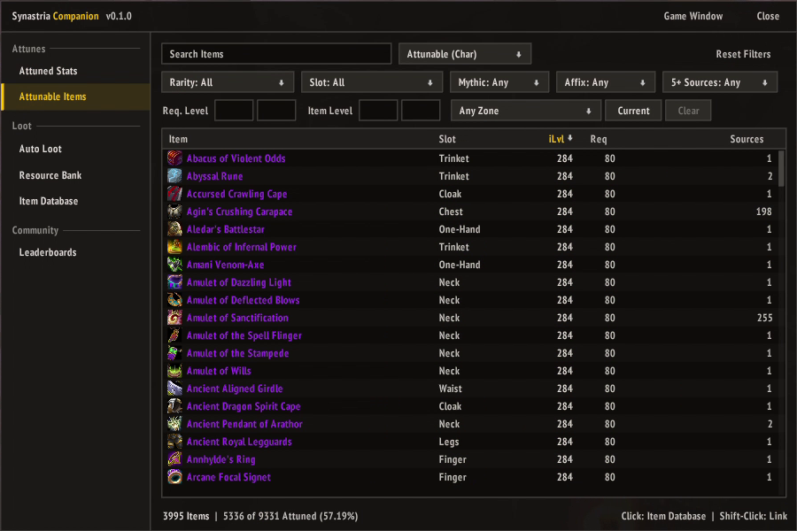
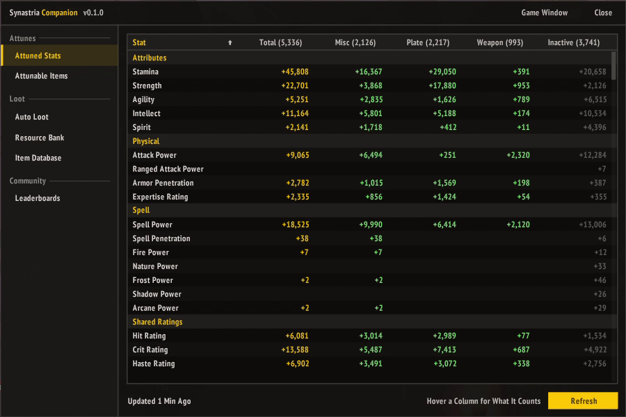
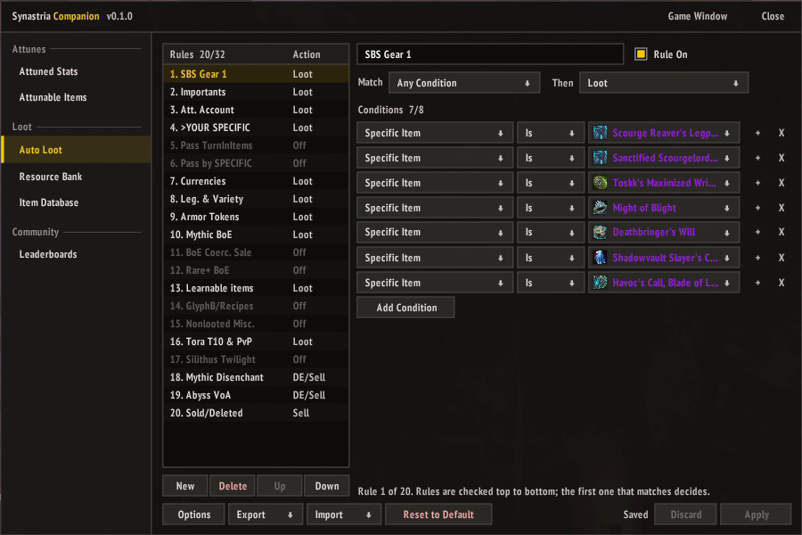
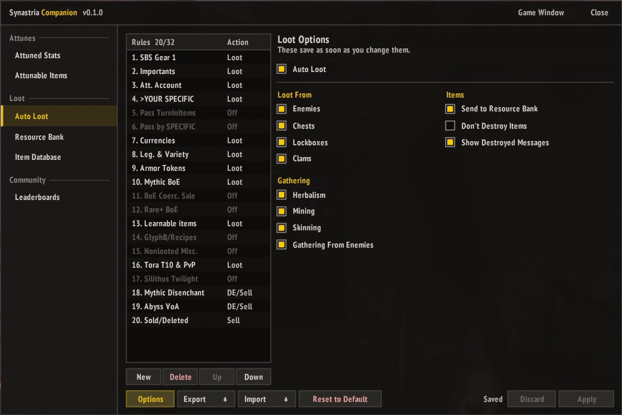
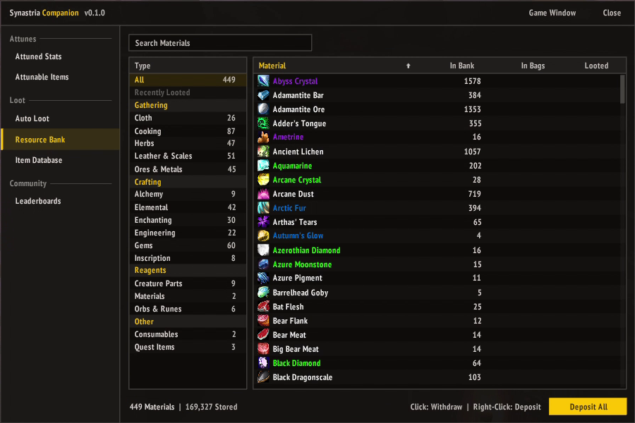
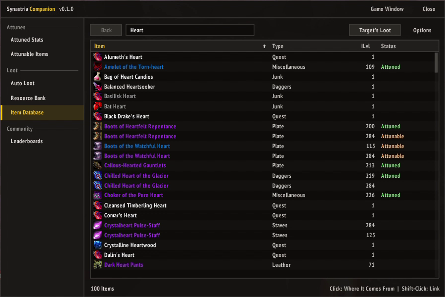
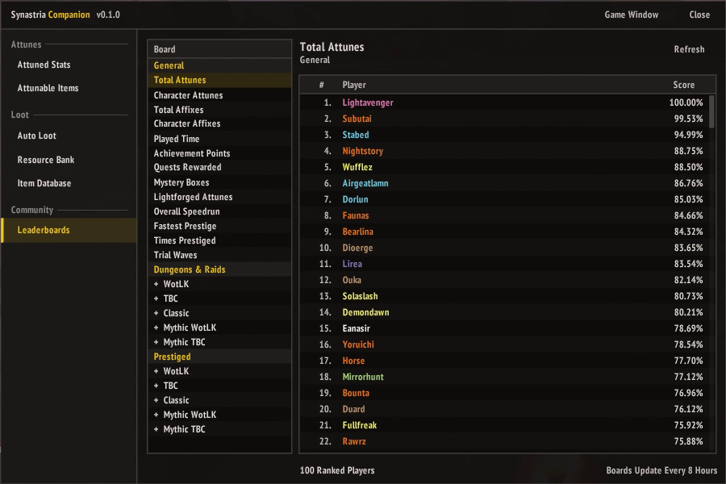

# Synastria Companion

Cleaner replacements for Synastria's own windows (WoW 3.3.5a), all in one window that matches
[Synastria Build Suite](https://github.com/iExpulsion/SynastriaBuildSuite): your perks, transmog, your attuned stats, the
attunable item search, the auto loot filter, the resource bank, the item database and the leaderboards. When the game would open
one of its windows, Companion opens instead.

## Features

- **One Window:** every screen sits in one sidebar, grouped into Character, Attunes, Loot and Community, and a
  minimap button or a data bar like ElvUI's opens any of them.
- **Perks in One Place:** every perk by category with its limit, the effect at your rank and the next, set bonuses,
  options, and what the next rank takes and how far along you are.
- **A Wardrobe for Transmog:** your character with a button for every slot, a searchable grid of models for each
  slot's appearances, item sets with their recolors, where you pick which pieces to put on, and looks saved for
  your whole account. Hovering any of them tries it on your character.
- **No View Spells Needed:** screens that need the game's View spell cast it on the same click that opens them,
  so those spells can come off your action bars.
- **Live Filters:** searches and filters apply as you type, with no Search button, and no cap on results.
- **Sortable Tables:** click any column heading to sort by it, and again to reverse it.
- **Attuned Stats at a Glance:** every stat your attuned items give, with what this character actually gets.
- **Easier Loot Rules:** a searchable list of conditions, item icons with tooltips, counters for the rule and
  condition limits, and changes that wait for Apply.
- **A Sorted Resource Bank:** materials by type, including the ones the game files as "Other", with what you carry
  next to what's stored.
- **Drop Chains:** follow an item to the creature that drops it, see the rest of that creature's loot, and step
  back.
- **Your Leaderboard Place:** every board in one list, with your rank highlighted and the speed buff times on top.
- **The Game's Window When You Want It:** the **Game Window** button opens the game's own window for any screen.
- **Themes:** the flat Material look, Classic for the game's own frames and buttons, or Cognac's painted gold
  frames on dark glass.

## Installation

1. Download the latest release.
2. Extract the `SynastriaCompanion` folder into `World of Warcraft\Interface\AddOns`.
3. Restart the game, or log out to the character screen and back in.

## Getting Started

Open Synastria Companion with `/scomp`, the minimap button, or anything that would open one of the game's windows,
such as its View spells. Left-click the minimap button to open or close the window, or right-click it to pick a
screen. Drag it to move it around the minimap, or Shift-drag it to place it anywhere on screen. Drag the title bar to move the window, and `/scomp reset` puts it back at the top middle of the screen.
Companion is also a LibDataBroker launcher, so data bars like ElvUI's data texts can show it with the same
left and right clicks.

The server only sends your attuned stats when asked, so the first time you open **Attuned Stats** the same click
asks for them. Clicks can only ask out of combat.

## The Window

- **Sidebar:** the screens, under Character, Attunes, Loot and Community. Companion remembers the last one you used.
- **Title Bar:** **Theme** switches between Material, Classic and Cognac, after a reload; Companion offers to reload for
  you. **Game Window** closes Companion and opens the game's own window for the screen you're on. **Close** closes
  it.
- **Footer:** counts sit at the bottom left, and the bottom right shows what clicking a row does.

### Perks

Your perks by category, as the game lists them, with how many each category allows next to its name. Each perk
shows its rank, and **Active** marks the active ones. Click a category to collapse it, and again to open it.
**All** and **Active** switch between every perk and only the active ones, and the search narrows by name.

**Tasks** lists what your active perks are working toward, grouped by kind of task, with your progress on
each. The group heading shows how many party members are on the same kind of task, since they help it along.

Click a perk for its details: the effect at your rank and the next one, how it works with other perks, its set and
which set bonuses are active, the ability it grants, its options, and **How to Unlock** or **How to Upgrade** with
your progress. Options and abilities change anywhere.

Perks are activated and deactivated at an innkeeper, as in the game: talk to one and pick **Manage Perks**, and
the **Activate** button (or a right-click on the perk) works until you close the window. The View Perks spell opens the
screen to look only. Opening [Synastria Build Suite](https://github.com/iExpulsion/SynastriaBuildSuite) from the
innkeeper keeps Companion out of its way, and builds still apply.

### Transmog

Laid out like the retail wardrobe, in a larger window than the other screens (it shrinks to fit smaller screens).
Along the top: pick one of your ten transmog looks from **Look** (**Active**
marks the one you're wearing), rename it, and **Activate** it. **Auto Activate on Spec**, above your character,
chooses the specs that switch it on automatically.

Your character stands on the left, wearing the look, with a button for each slot around it and a small enchant
visual button under each weapon. A slot can keep your **Equipped Look**, be **Hidden**, or show any item you've
attuned or acquired; a red slot holds an item you haven't, which won't apply, and a cross marks a hidden one. Drag your character to turn it
around. Under it, **Naked** shows only what you're trying, with nothing else on, and **Show Background** puts your
race's background behind your character.

Click a slot to see its appearances under **Items**: a page of twelve models as big as the game's own, each
wearing one appearance, framed on that slot. What the slot is set to now shows beside its name. There's a type filter (armor type or weapon type) and a search, the arrows or the mouse wheel turn the page,
and **Show Duplicates** also lists items that look the same as one already listed. Hovering an appearance tries it
on your character; click one to choose it. Right-click a slot to go back to your equipped look.

The **Sets** tab lists the game's item sets, from dungeon and tier sets to PvP gear, and **Matching Gear**: armor
made to be worn together that the game lists in no set, like the Thistlefur and Abjurer's outfits. Filter them to
your class, armor type and kind, or show everything, with a search. **Pieces** shows how many of a set's pieces you can use, counting any item you have
with the same look as a piece (the set's tooltip names it), and hovering a set tries it
all on the preview. A set's recolors, like the Sanctified tier pieces, the 10- and 25-player versions and each
arena season's version, are grouped under it: its row shows the version you have the most of, and clicking it
lists every version. Click a set (or a version) to choose it: its pieces show beside the list, the ones you've
attuned or acquired checked, and your character wears the checked ones. Uncheck any you don't want, then **Put On
Selected** puts them on the look; the slots it doesn't cover keep what they had, and the footer says how many
pieces were left out.

The **Saved** tab keeps looks for every character on your account, beyond the ten each character has. Type a name
and click **Save This Look** (a blank name uses the look's own; saving under a name you already have updates it).
Saved looks show as a page of models by name, each your character wearing the whole look, with how many of its
items you can use under it. Hovering one also tries it on your character, clicking one loads it into the selected
look, and right-clicking one deletes it.

**Activate** wears the look, or turns transmog off when it's already the active one, and **Import** and **Export**
beside it share a look as text. Along the bottom, **Use Equipped** fills every slot from what you're wearing and
**Reset** clears it. Every change saves at once.

### Attuned Stats

One table of every stat your attuned items give, grouped like a character sheet: Attributes, Physical, Spell,
Shared Ratings, Defense, Regeneration and Resistances. **Total** is what this character actually gets, made up of
Misc, your armor type and Weapon. **Inactive** counts attuned gear this character can't use. Hover a column heading
for what it counts, and sort by any column to see your biggest bonuses first.

**Refresh** asks the server for the latest numbers. The footer shows how long ago they were updated.

### Attunable Items

The attune search, rebuilt. Every result is shown (the game's window stops at 500), and the filters apply as you
type. It has the game's filters: the mode (Attunable or Attuned, for this character or the account, or All), class
for multi-class characters, rarity, slot, Mythic, Affix, more than five sources, required level, item level and
zone. The zone list starts with **Current Zone** for the zone you're in.

**Advanced** opens a drawer beside the window with filters the game's window doesn't have. They apply only while
the drawer is open, and the button shows how many are set; close it and you're back to the game's filters, with
your advanced choices kept for next time.

- **Affix:** items with affixes you haven't attuned yet, or every item that can roll one affix you still need, such
  as "of the Bear".
- **Affix Forge:** whether affixes count as attuned at the base level, Titanforged, Warforged or Lightforged.
- **Attunement:** Not Attuned, Attuned, or the best forge level reached (TF, WF, LF). Pick several to combine them.
  The mode follows: an attuned level switches Attunable (Char) to Attuned (Char), and mixing in Not Attuned
  switches to All.
- **Bind:** BoP or BoE.
- **Source:** items that drop in dungeons, raids or the open world.
- **Expansion:** Classic, The Burning Crusade or Wrath of the Lich King, from the zones the item comes from (or
  its required level when none is known).

Source and Expansion read every item's sources the first time you use them, which takes a few seconds.

The table sorts by item, slot, item level, required level or sources. While Advanced is open, an **Affixes**
column shows how many of an item's affixes you've attuned at the Affix Forge level, such as 3/32 (a dash for items
without affixes); sorting it puts the most left to attune first. In the modes that list attuned items, a **Forge** column shows
each item's forge level in the game's colors. The footer shows the attuned share of everything your filters match.

Click an item to open it in the Item Database, or Shift-click it to link it.

### Auto Loot

The game's loot filter. The rules are on the left, in the order they're checked: the first rule that matches an
item decides what happens to it. Drag a rule up or down the list to change when it's checked. Select a rule to edit
it on the right: its name, whether it's on, what has to match
(all conditions, any of them, or the first and any other), what to do with the item, and its conditions. Counters
show how close you are to the limits of 32 rules and 8 conditions per rule.

Pick a condition from a searchable list, with a description on hover. Each value gets the control that fits it: yes
or no, a number, one or several choices, an item search, or a zone. Items show their icon and tooltip, and **+**
copies a condition.

Changes wait for **Apply**, and **Discard** throws them away. Turning a rule on or off saves at once when nothing
else is waiting. Sharing uses the game's own share strings, so filters other players post still work: **Import**
under the list adds a shared rule, **Export** above a rule copies it, and **Import Filter** and **Export Filter** at
the bottom cover the whole filter. **Reset to Default** asks for a second click.

**Options** holds the Auto Loot switch and what it covers: what you loot from, gathering, and what happens to looted
items. Hover an option for what it does. Like turning a rule on or off, options save at once when nothing else is
waiting.

### Resource Bank

The type list on the left starts with All and Recently Looted, then every type with how many materials it holds,
in Gathering, Crafting, Reagents and Other sections. Click one to show just that type. Materials the game files as
"Other", such as pigments, vials, orbs and venom sacs, are sorted into the type they're used with.

The table shows how many of each material are in the bank, in your bags and recently looted. Click a material to
withdraw a stack, right-click it to deposit every stack you carry, or click **Deposit All**. The list updates as the
bank changes.

### Item Database

The game's loot database. Search every item, then click one to see where it comes from: a table of its sources with
their type, zone, drop chance and drops per 1000. Quests for the other faction are left out. Right-click a source to
track it on the map.

Click a creature or container to see everything it drops, or click **Target's Loot** for your target's. **Still to
Attune** narrows that list to what you haven't attuned. **Back** steps through everything you opened, so you can
follow a drop chain and return. **Options** opens the game's loot database settings, such as Alt-click to open
items and source lines in tooltips.

### Leaderboards

Every board in one list: the general boards, then dungeons and raids by expansion (WotLK, TBC, Classic and their
Mythic versions), then prestiged runs. Click an expansion to open its boards.

Each board shows its ranks with the player, their account, the score (a count, a time or a percentage) and, on
boards that have one, the date. Your own place is highlighted and scrolled into view, and the times for the speed
buff show at the top. **Refresh** asks for a board again; the server answers at most once a minute per board.

## Commands

`/companion` works everywhere `/scomp` does.

| Command | Does |
|---|---|
| `/scomp` | Opens or closes the window |
| `/scomp perks` | Opens Perks |
| `/scomp transmog` | Opens Transmog (also `tmog`) |
| `/scomp attuned` | Opens Attuned Stats (also `stats`) |
| `/scomp attunable` | Opens Attunable Items |
| `/scomp lootfilter` | Opens Auto Loot (also `autoloot`) |
| `/scomp bank` | Opens the Resource Bank |
| `/scomp lootdb` | Opens the Item Database (also `itemdb`) |
| `/scomp leaderboards` | Opens Leaderboards |
| `/scomp minimap` | Hides or shows the minimap button |
| `/scomp minimap reset` | Puts the minimap button back on the minimap |
| `/scomp reset` | Moves the window back to the top middle of the screen |
| `/scomp theme <name>` | Switches the theme after a reload: `material`, `classic` or `cognac` |
| `/scomp pixel` | Turns pixel snapping off or back on (see below) |
| `/scomp replace <screen> off` | Gives a screen back to the game's own window; `on` takes it back |

Companion's windows snap to whole screen pixels, so their borders stay crisp. At most UI scales that makes the
window a little larger or smaller than the rest of your UI; `/scomp pixel` turns it off if you'd rather it matched
exactly.

## Credits

Thanks to **Lulleh** for finding the cause of the window's drag lag.

## License

Synastria Companion's code is released under the [MIT License](LICENSE). The Cognac art in
`SynastriaCompanion/UI/Skins/Cognac` is from [AttuneNext](https://github.com/speedyrulz/AttuneNext) and isn't
covered by it. `SynastriaCompanion/Libs` holds LibStub and LibDataBroker-1.1 (public domain) and
CallbackHandler-1.0 (from Ace3, under its own BSD-style license).
